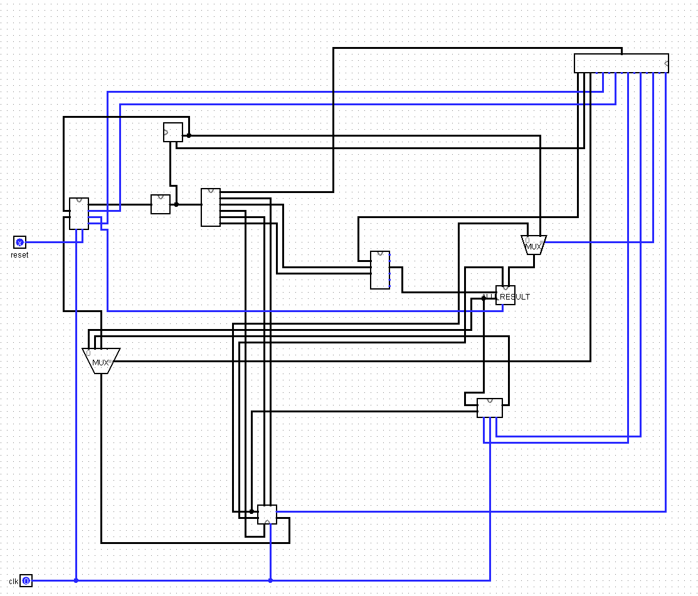

# 32-bit RISC-V Single-Cycle CPU | Logisim & SystemVerilog

A 32-bit, single-cycle CPU implementing a subset of the RISC-V RV32I instruction set. The processor was first designed and tested in **Logisim**, then implemented at the RTL level in **SystemVerilog** using **Intel Quartus Prime**. Module-level SystemVerilog testbenches were also developed.

The goal of this project is to demonstrate a complete processor datapath, control logic, and a progression from schematic-level design to RTL implementation and verification.

## Architecture



The design uses a **single-cycle datapath**: each supported instruction completes in one clock cycle, without pipelining.

### Main components

- **Program Counter (PC):** Maintains the instruction address and selects the next PC for sequential, branch, or jump execution.
- **Instruction Memory:** Supplies the instruction addressed by the PC.
- **Instruction Decoder / Splitter:** Extracts opcode, register addresses, and function fields.
- **Register File:** 32 registers of 32 bits each, with two read ports, one write port, and `x0` fixed at zero.
- **Immediate Generator:** Produces sign-extended immediates for I-, S-, B-, and J-type instructions.
- **Main Control Unit:** Generates control signals from the instruction opcode.
- **ALU Control Unit:** Selects the required ALU operation.
- **32-bit ALU:** Performs arithmetic and logical operations and generates the comparison result needed for `BEQ`.
- **Data Memory:** Supports load and store operations.
- **Datapath Multiplexers:** Select the ALU's second operand and the data written back to the register file.

The branch/jump next-PC selection is handled as part of the Program Counter logic in the updated design.

## Supported Instructions

This processor supports **nine RV32I instructions**; it does not implement the complete RV32I ISA.

| Instruction | Format | Function |
| --- | --- | --- |
| `ADD` | R | `rd = rs1 + rs2` |
| `SUB` | R | `rd = rs1 - rs2` |
| `AND` | R | `rd = rs1 & rs2` |
| `OR` | R | Bitwise OR of `rs1` and `rs2` |
| `ADDI` | I | `rd = rs1 + immediate` |
| `LW` | I | Load a 32-bit word from data memory |
| `SW` | S | Store a 32-bit word to data memory |
| `BEQ` | B | Branch if `rs1 == rs2` |
| `JAL` | J | Jump and write `PC + 4` to `rd` |

## Instruction Execution

For a sequential instruction, the next PC is:

```text
next_pc = pc + 4
```

For a taken `BEQ` or a `JAL`:

```text
next_pc = pc + sign_extended_immediate
```

A `BEQ` changes the PC only when the two source registers compare equal. A `JAL` also writes the return address (`PC + 4`) to the destination register.

## SystemVerilog RTL Implementation

After completing the Logisim design, the processor modules were implemented in SystemVerilog. The RTL includes a top-level CPU module that connects the datapath and control components.

The design work covers the Program Counter, ALU, Register File, Instruction Memory, Immediate Generator, control units, and Data Memory.

**Publication status:** The Logisim files are available in this repository. The SystemVerilog source files and testbenches have been developed separately and are not yet included in the published file list below. This section will be updated with file links and reproducible simulation instructions when they are uploaded.

## Verification

### Logisim functional tests

Directed programs were used to test the supported instructions. The following outcomes are reported from the Logisim verification work:

| Test category | Instructions / behavior | Reported result |
| --- | --- | --- |
| Arithmetic | `ADD`, `SUB`, `ADDI` | Passed |
| Logic | `AND`, `OR` | Passed |
| Memory access | `SW`, `LW` | Passed |
| Control flow | `BEQ`, `JAL` | Passed |
| PC sequencing | `PC + 4`, branch and jump targets | Passed |

Example arithmetic test:

```assembly
ADDI x7, x0, 10
ADDI x9, x0, 20
ADD  x2, x7, x9
```

Expected and observed register values in Logisim:

```text
x7 = 10
x9 = 20
x2 = 30
```

A separate memory test stored and then loaded the value `42` using `SW` and `LW`.

### SystemVerilog module-level tests

SystemVerilog testbenches were written for individual modules. These are separate from the Logisim directed programs. Testbench source files, simulation outputs, and any end-to-end RTL results will be linked here after they are published; no unprovided RTL pass counts or coverage metrics are claimed.

## Running the Logisim Design

1. Download [`rv32i_single_cycle_cpu.circ`](rv32i_single_cycle_cpu.circ).
2. Open it with **Logisim 2.7.1**.
3. Open the `CPU_Top` circuit.
4. Load or edit a test program in the Instruction Memory.
5. Select **Simulate → Reset Simulation**.
6. Toggle the clock from `0 → 1 → 0` for each instruction.
7. Observe the Program Counter, Register File, and Data Memory to inspect execution.

> **Note:** Quartus is used for RTL development. Running SystemVerilog testbenches requires a compatible simulator; simulator commands and logs will be documented when the RTL files are published.

## Repository Files

```text
README.md                    Project documentation
image.png                    Updated CPU datapath screenshot
rv32i_single_cycle_cpu.circ  Logisim CPU implementation
```

## Current Limitations

- Supports only the nine instructions listed above, not the full RV32I instruction set.
- Uses a single-cycle architecture with no pipeline.
- Does not implement caches, interrupts, or exception handling.
- No FPGA deployment or performance/frequency claims are included in this documentation.

## Author

**Abed Alrahman Yosef**  
B.Sc. Electrical Engineering Student — Tel Aviv University  
[LinkedIn](https://www.linkedin.com/in/abed-yosef-907527209)
